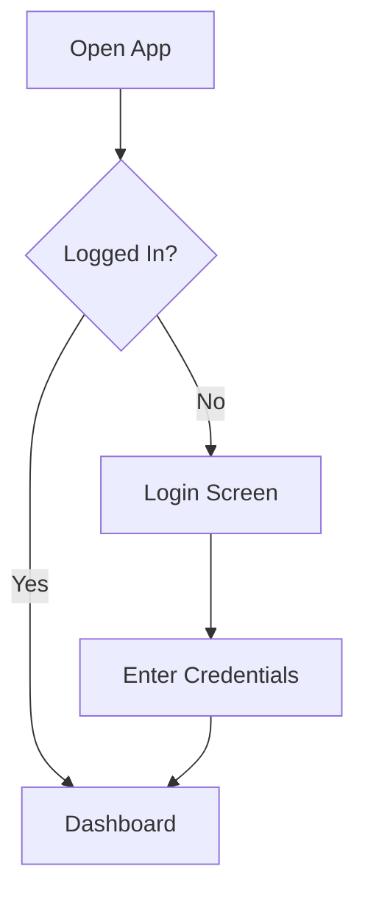
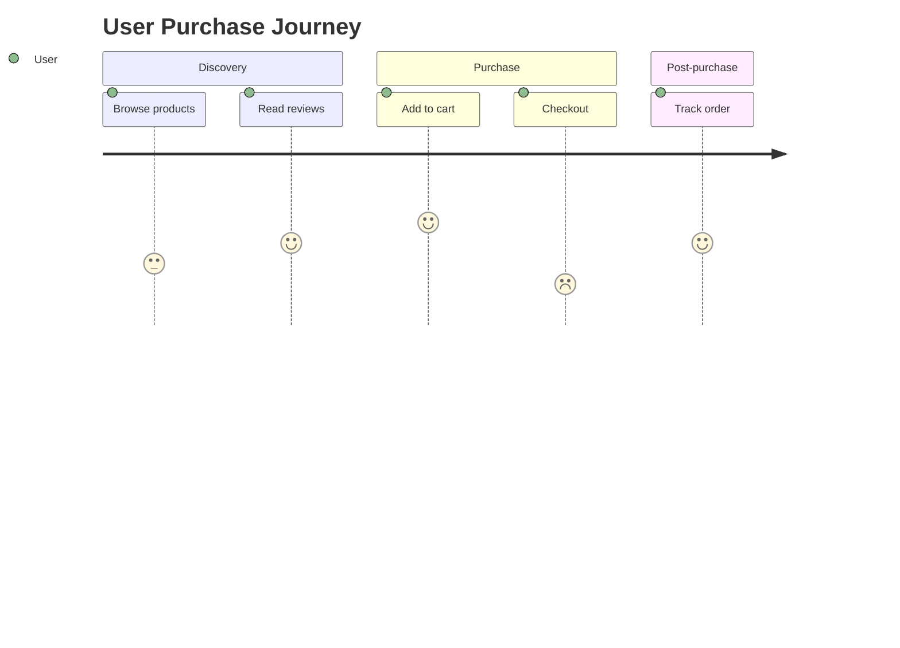
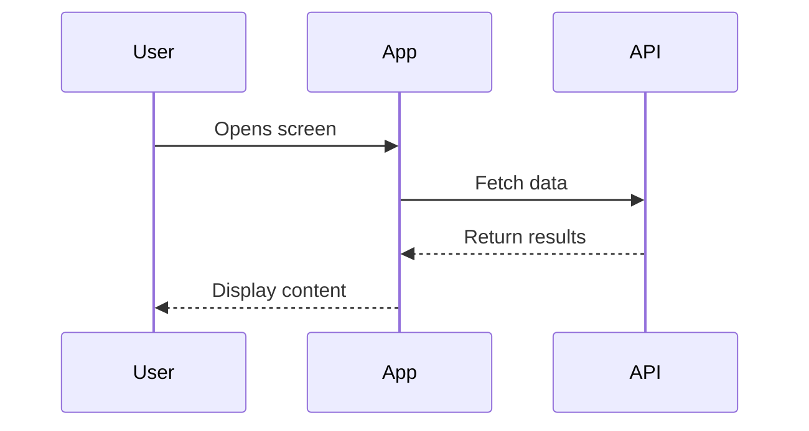
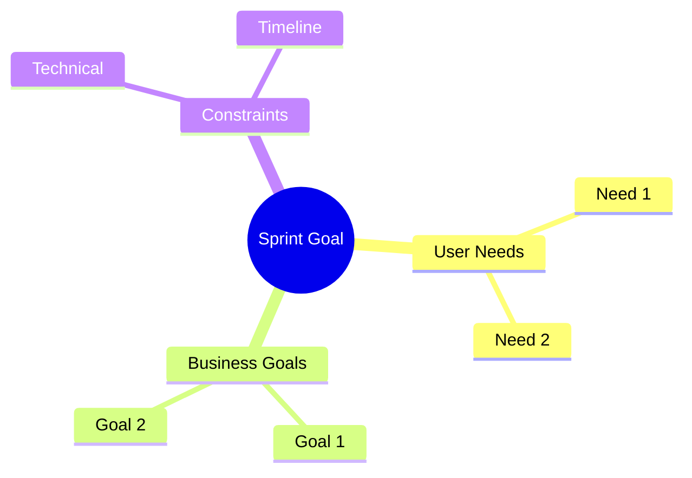
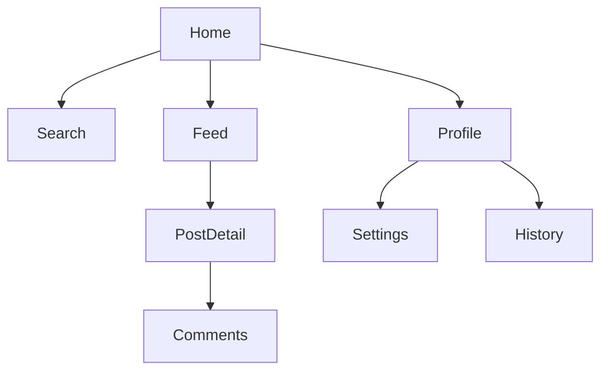

# Concept Visualization

## Diagram Types

### Mermaid Diagrams
Mermaid renders in most Markdown viewers (GitHub, VS Code, etc.).

#### User Flow


#### Journey Map (visual)


#### Sequence Diagram (interactions)


#### Mind Map (ideation)


#### Information Architecture


### ASCII Diagrams
For simple layouts or when Mermaid is overkill:

```
┌─────────────────────┐
│     Header Bar      │
├─────────────────────┤
│                     │
│   Content Area      │
│                     │
├─────────────────────┤
│ Tab 1 │ Tab 2 │ Tab3│
└─────────────────────┘
```

### Wireframe Sketches (ASCII)
```
┌──────────────────┐
│ ← Back    Title  │
├──────────────────┤
│ ┌──────────────┐ │
│ │  Image       │ │
│ └──────────────┘ │
│ Heading Text     │
│ Description...   │
│                  │
│ [Primary Action] │
│  Secondary Link  │
└──────────────────┘
```

## Analogies and Mental Models

When explaining complex concepts:
1. Identify what the team already understands
2. Find a parallel structure in a familiar domain
3. Map the key relationships
4. Note where the analogy breaks down

## When to Use What

| Situation | Tool |
|-----------|------|
| User flow or navigation | Mermaid flowchart |
| API or system interaction | Mermaid sequence diagram |
| Brainstorming or categorizing | Mermaid mind map |
| Screen layout exploration | ASCII wireframe |
| Information architecture | Mermaid flowchart (tree) |
| Emotional journey | Mermaid journey diagram |
| Simple relationship | ASCII or bullet points |

## Output Location

- Embed diagrams directly in the relevant `docs/` files
- For standalone visualizations, save in the appropriate docs subdirectory
- Reference diagrams in sprint journal entries
